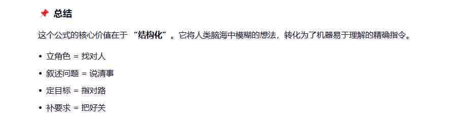

#### 问题1:什么是Prompt
```java
Prompt（提示词）是人与 AI 模型交互的“指令”或“输入”。你可以把它想象成你给 AI 下达的任务书或沟通的桥梁。AI 本身并没有自主意识，它完全依赖 Prompt 来理解你的意图，并据此生成相应的回答或内容。
它是人机交互的核心接口，决定了模型理解任务意图的准确度。一个高质量的 Prompt 通常包含以下关键要素：
1.角色设定：指定模型扮演的身份（如“你是一位资深程序员”）。
2.任务背景：提供必要的上下文信息或约束条件。
3.具体指令：清晰描述需要执行的操作（如“总结”、“翻译”、“编写代码”）。
4.输出格式：规定回答的结构、风格或长度。
```
***
#### 问题2:什么是Prompt工程
> 背景
```java
Prompt 工程（Prompt Engineering，提示词工程），简单来说，就是一门“教 AI 听懂人话并完美干活”的科学与艺术。
如果把大语言模型（如 Qwen、ChatGPT）比作一个拥有海量知识但偶尔有些“一根筋”的超级实习生，那么 Prompt 工程就是你编写工作说明书、沟通技巧和流程优化的方法论。它不仅仅是“随便问个问题”，而是通过系统性地设计、优化和迭代提示词，来引导 AI 输出最准确、最符合预期的结果。
```
> 是什么
```java
Prompt工程通过设计提示词 以确保LLM最佳输出过程称为[提示词工程] 由于LLM对提示词的变化极其的敏感 提示词非常微小的改动 会导致LLM大相径庭的输出 
通俗的讲  通过精心设计指令 提升LLM单次特定任务的回答准确率
```
***


#### 问题3:一个好的提示词的4要素
- 【立角色】
```java
告诉 AI 它应该扮演什么身份。例如：“你是一个资深的心理咨询师”或“你是一个精通 Python 的程序员”。这能引导 AI 调整其回答的语气、专业度和视角。
```
- 【叙述问题】
```java
告诉 AI “发生了什么”或“现状是什么”。这是任务的背景信息，包括输入的数据、遇到的困难、或者具体的场景描述。
```
- 【定目标】
```java
告诉 AI “你要做什么” 要达到什么效果 这是指令中最关键的动作部分，必须清晰、具体。
```
- 【补要求】
```java
告诉 AI “怎么做”以及“做成什么样”。这是对输出的格式、风格、字数、禁忌等的限制。
```
***

***
#### 问题4:提示词案例拆解分析
> 提示词
```java
你现在是一个专业的软件需求分析师与应用架构师 后面的问题 请你以专业人士的视角回答 我要做员工打卡的考勤应用 请你帮忙生成一份需求文档 与 样例代码 做个Demo 代码用python输出
```
> 分析
```java
// 1.立角色
		// 1.1 你现在是一个专业的软件需求分析师与应用架构师

// 2.叙述问题
		// 2.1  请你以专业人士的视角回答 我要做员工打卡的考勤应用

// 3.定目标
		// 3.1 请你帮忙生成一份需求文档 与 样例代码

// 4.补要求
		// 4.1 做个Demo 代码用python输出
```
***

#### 问题5: prompt开发过程中 如何立角色
```java
在 Prompt 开发中，“立角色”（Role Setting）的核心目的是通过赋予 AI 特定的专家身份，激活其对应的知识库、思维模式和语言风格，从而提升回答的专业度和准确度。以下是立角色的关键步骤与技巧：
1. 明确角色的具体身份
避免使用模糊的词汇（如“专家”），应尽可能具体化。

一般描述：你是一名营销专家。

具体角色：你是一名拥有 10 年经验的 SaaS 行业首席营销官（CMO），擅长 B2B 获客策略和内容营销。

2. 定义角色的核心能力与背景
简要说明该角色擅长的领域、使用的工具或遵循的标准，以约束 AI 的回答范围。

示例：你精通 SEO 优化、A/B 测试分析，并熟悉华为云的市场推广规范。

3. 设定语气与沟通风格
规定角色在回答问题时应采用的语调，确保输出符合目标受众的期待。

专业严谨：适合技术文档、法律建议、数据分析。

亲切幽默：适合社交媒体文案、用户引导、创意写作。

简洁直接：适合代码解释、操作指南、摘要生成。

4. 提供角色约束与边界
明确角色“不做什么”或“遵循什么原则”，防止 AI 产生幻觉或偏离主题。

示例：请仅基于公开的技术文档回答，不要编造不存在的 API 接口；如果不确定，请明确告知“我不知道”。

5. 结合任务场景强化角色
将角色与具体任务紧密结合，使角色设定更具操作性。


示例：作为一名资深 Python 后端工程师，请帮我审查以下代码的安全性，重点关注 SQL 注入风险和内存泄漏问题，并以代码注释的形式给出修改建议。


例子
✅ 强角色设定：

角色：你是一名资深的科技产品文案策划，擅长将复杂的技术参数转化为用户可感知的利益点。
背景：我们正在向非技术背景的企业高管推销一款新的 AI 数据分析平台。
任务：撰写一段 100 字以内的产品介绍。
风格：专业、自信、简洁，避免使用晦涩的技术术语，重点突出“降本增效”和“决策支持”。
```

#### 问题6: prompt在开发过程中 如何定目标
```java
在 Prompt 开发中，“定目标”（Task Definition）的核心是明确 AI 需要执行的具体动作、交付物的形态以及成功的标准。清晰的目标能减少 AI 的猜测，确保输出直接可用。以下是定目标的五个关键维度：
1. 明确核心动作（Action）
使用动词清晰界定 AI 需要做什么，避免模糊指令。

模糊：帮我处理这段文字。

清晰：提取这段文字中的关键数据，并整理成表格。* 常见动词：撰写、总结、翻译、调试、分析、生成、对比、润色。

2. 定义输出格式与结构（Format）
规定结果的呈现方式，确保符合后续使用场景。

文本类：指定字数、段落数、语气风格（如“幽默”、“正式”）。

结构化类：指定格式（如 Markdown 表格、JSON、CSV、HTML 代码块）。

示例：请以 Markdown 表格形式输出，包含“功能点”、“优先级”、“负责人”三列。

3. 设定约束条件与边界（Constraints）
明确“不做什么”或“必须遵循什么”，防止幻觉或偏离主题。

内容约束：仅基于提供的材料回答，不要引入外部知识。

逻辑约束：回答需符合逻辑一致性，避免自相矛盾。

安全约束：不包含敏感信息，不生成违规内容。

示例：不要解释原理，直接给出代码；如果数据缺失，请标记为“N/A”。

4. 指定参考标准或样例（Few-Shot/Examples）
通过提供示例（Few-Shot Prompting），让 AI 模仿特定的输出风格或逻辑。

示例：

输入：苹果

输出：水果，红色，甜味

输入：香蕉

输出：水果，黄色，软糯

（让 AI 按照此格式处理后续输入）

5. 定义成功标准（Success Criteria）
描述什么样的输出才算“好”，便于 AI 自我校验或用户验收。

准确性：数据需与源文档完全一致。

完整性：覆盖所有提到的问题点。

可读性：语言简洁，无冗余修饰。


例子
✅ 强目标设定：

动作：撰写一封商务道歉邮件。
对象：发给重要客户，解释项目延期原因。
格式：邮件正文，包含主题行。
约束：语气诚恳专业，不超过 200 字，不推卸责任，提出具体的补救措施。
样例风格：参考以下语气：“非常抱歉给您带来不便，我们已采取以下措施……”
```
#### 问题7 prompt在开发过程中 如何补要求
```java
补要求旨在通过细化约束、格式、边界和示例，消除 AI 输出的模糊性与不确定性，确保结果精准可用。
1. 细化输出格式与结构
明确结果呈现方式，便于直接复用。

格式指定：如 Markdown 表格、JSON、CSV、HTML 代码块、纯文本等。

结构约束：如“分三点回答”、“包含标题、正文、结论”、“字数控制在 200 字以内”。

示例：请以 Markdown 表格输出，包含“功能”、“优先级”、“状态”三列。

2. 设定负面约束与边界
明确“不做什么”，防止幻觉或偏离主题。

内容边界：如“仅基于提供材料回答”、“不引入外部知识”、“不包含敏感信息”。

逻辑边界：如“避免自相矛盾”、“不解释原理，直接给结果”、“不使用比喻修辞”。

示例：不要输出任何解释性文字，只返回 JSON 数据；如果数据缺失，请标记为 null。

3. 提供少样本示例（Few-Shot）
通过输入-输出对，让 AI 模仿特定风格或逻辑。

风格模仿：提供 1-3 个符合预期的问答对，引导 AI 学习语气、格式或推理路径。

逻辑示范：展示复杂任务的处理步骤，如“先提取关键词，再分类，最后总结”。

示例：

输入：苹果

输出：水果，红色，甜味

（让 AI 按此格式处理后续输入）

4. 定义成功标准与校验规则
描述“好结果”的特征，辅助 AI 自我校验。

准确性：数据需与源文档完全一致。

完整性：覆盖所有提问点，无遗漏。

可读性：语言简洁，无冗余修饰，符合目标受众阅读习惯。

示例：确保所有日期格式统一为 YYYY-MM-DD；专业术语需附带英文缩写。

5. 指定思维链（Chain of Thought）
对于复杂任务，要求 AI 展示推理过程，提升逻辑严密性。

步骤拆解：要求 AI 先分析、再推理、最后给出结论。

自我反思：要求 AI 在输出前检查逻辑漏洞或事实错误。

示例：请逐步分析原因，列出证据，最后给出结论。


```

#### 问题8:常见的prompt的分隔符有哪些
```java
常见的 Prompt 分割符主要包括以下几类，用于清晰界定指令、上下文、输入数据等不同部分，防止内容混淆：
三重引号
-格式：""" 或 '''

适用场景：最通用的文本块分隔，常用于包裹大段背景信息或输入数据。

XML 标签

格式：<tag>内容</tag>，如 <context>、<input>、<instruction>

适用场景：结构清晰，易于解析，适合复杂指令或需要明确语义区分的场景。

Markdown 标题

格式：###标题 或 ## 标题

适用场景：利用层级结构区分不同模块，如 ### 背景信息、### 任务要求。

特殊符号组合

格式：---、***、===

适用场景：简单的视觉分隔，适用于简短指令或段落间的切分。

括号与引号

格式：【】、[]、""

适用场景：包裹简短的关键信息或变量，如 用户输入：【{text}】。

反引号

格式：` 或 ```

适用场景：主要用于代码块或需要保留原始格式的技术内容。
```


#### 问题9:如何进行提示词的优化
> 核心优化原则
```java
// 1.明确任务与角色
	// 1.1 清晰定义任务目标与模型角色（如“作为信息抽取专家”）
	// 1.2 避免模糊描述，限定输出格式（JSON/表格/分点）
// 2.信息密度与结构
	// 2.1 控制Prompt长度在100-300字黄金区间
	// 2.2 采用“总述-分点-原因-方案-总结”分层结构
```
> 关键优化技巧
```java
// 1.少样本学习（Few-shot）
	// 1.1 提供1-3个优质示例引导输出风格
	// 1.2 示例需覆盖任务典型场景与期望格式
// 2.思维链（Chain of Thought）
	// 2.1 添加“让我们一步步思考”等引导词
	// 2.2 强制模型分步推导，避免逻辑跳跃
// 3.角色化提示
	// 3.1 锁定专业角色（如AI产品经理/研发工程师）
	// 3.2 模型自动采用结构化职业思维输出
```
> 实用模板
```java
# 高阶优化模板  3   6 
角色：[专业角色，如“资深算法工程师”]
任务：[具体任务描述]
输出要求：
1. 采用[指定结构，如“总-分-总”]
2. 分步骤推导核心逻辑
3. 每个结论需附依据
4. 禁止重复和冗余内容
示例：[1-2个典型示例]
```
#### 问题10:多模态信息提取方法
多模态指的是什么: 视频 音频 图像
```java
// 核心逻辑：采用"文本引导+模态补充"策略，文本提示明确任务需求，图像/音频等模态提供上下文信息
// 1.关键技术流程：
	// 1.1 数据预处理：对异构模态数据标准化（文本向量化、图像特征编码、语音频谱分析）
	// 1.2 跨模态注意力机制：建立模态间关联矩阵，动态调整各模态特征权重
	// 1.3 分层特征提取：依次执行上下文语义理解、实体关系建模、核心信息定位

```
> 多模态提示核心构建技巧
```java
1. 明确任务与格式约束
	指定输出格式：明确要求JSON、表格等结构化输出 
	限定回答范围：聚焦特定区域或特定方面

案例对比：
模糊提示：“这张图说明什么” → 浅层回答 2
明确提示：“根据天气图分析明天应该穿什么衣服” → 实用建议
```
> 样例
```java
反例：直接提问得到模糊答案"很快就会用完"
优例：分步指令：
1. 数图片中卫生纸卷数
2. 估算日均使用量  
3. 计算总使用时长  1 

```

#### 问题11:prompt有哪些典型的应用场景
```java
1. 内容创作与文案生成
营销文案：生成社交媒体帖子、广告标语、产品描述等，通过指定语气和目标受众提升转化率。

创意写作：辅助创作故事大纲、小说章节、诗歌或剧本，提供灵感或续写内容。

邮件与沟通：起草商务邮件、会议纪要或正式信函，优化语气和专业度。

2. 代码开发与技术支持
代码生成：根据自然语言描述生成特定编程语言（如 Python、Java）的代码片段。

代码调试与优化：识别代码中的错误、解释报错信息或建议性能优化方案。

注释与文档：为现有代码添加注释或生成技术文档。

3. 数据分析与信息处理
数据清洗与转换：将非结构化文本转化为结构化数据（如 JSON、CSV 格式）。

摘要与提炼：快速总结长篇文章、报告或会议记录的核心要点。

格式转换：将文本转换为表格、列表或其他特定格式。

4. 翻译与语言学习
多语言翻译：提供高质量的中英互译或其他语种翻译，支持专业术语的准确转换。

语言润色：纠正语法错误、提升表达流畅度或调整文体风格。

语言教学：解释语法概念、提供例句或进行模拟对话练习。

5. 角色扮演与模拟
面试模拟：扮演面试官或候选人，进行模拟面试并给出反馈。

客服模拟：模拟客户场景，训练客服人员的应对策略。

专家咨询：设定特定角色（如法律顾问、医生、教师），提供专业领域的初步建议或知识解答。

6. 逻辑推理与问题解决
数学与科学计算：解决数学题目、物理问题或进行逻辑推导。

决策支持：基于给定条件分析利弊，提供决策建议或风险评估。

7. 自动化工作流集成
API 调用代理：在 Agent 模式下，Prompt 用于引导模型调用外部工具（如搜索、数据库查询）以完成复杂任务。

RAG 增强检索：结合检索增强生成技术，基于私有知识库回答特定领域问题。
```
#### 问题12:图像生成prompt的三要素是什么
```java
图像生成 Prompt 的三要素通常指：

主体描述：明确画面中的核心对象、人物、动物或场景，包括其外观、动作、姿态等细节。

风格与媒介：定义图像的视觉风格（如写实、二次元、油画、赛博朋克）、艺术流派或拍摄媒介（如照片、插画、3D渲染）。

环境与光影：设定背景场景、构图视角、光照条件（如自然光、霓虹灯、逆光）及色彩基调，以营造氛围并增强画面层次感。
```

#### 问题13:设计多模态信息提取提示词的3大核心技巧是什么？
```java
设计多模态信息提取提示词的3大核心技巧包括：

1.明确模态与任务边界：清晰界定输入数据的模态类型（如图像、文本、音频）及具体的提取目标（如OCR文字识别、图像主体描述、情感倾向分析），避免指令模糊导致模型混淆处理逻辑。

2.结构化输出定义：规定输出的数据格式（如JSON、XML或特定表格结构），并明确字段名称、数据类型及层级关系，确保提取结果可直接被下游系统解析或入库。

3.提供少样本示例（Few-Shot）：提供包含典型输入及对应标准输出的示例，特别是涵盖边缘案例或复杂场景的样例，以引导模型理解提取规则、格式要求及上下文关联逻辑，提升准确率。
```

#### 问题14:为什么多模态提示词重要？
```java
多模态提示词的重要性主要体现在提升信息提取精度、规范输出结构及增强模型对复杂场景的理解能力。

1.提升跨模态理解精度
多模态数据（如图像、音频、文本）包含丰富的非结构化信息。通过精心设计的提示词，可以明确界定各模态的处理逻辑与关注重点，帮助模型准确捕捉关键特征，减少因指令模糊导致的误读或遗漏。

2.确保输出结构化与可用性
明确的提示词能够规定输出的数据格式（如 JSON、XML），定义字段含义与层级关系。这使得提取结果能够直接被下游系统解析、入库或进一步处理，显著降低后续数据清洗与整合的成本。

3.引导模型处理复杂逻辑
通过提供少样本示例（Few-Shot）和思维链引导，提示词能帮助模型理解边缘案例、上下文关联及特定的提取规则。这在处理复杂场景时尤为重要，能有效提升模型在真实业务环境中的鲁棒性与准确率。
```

#### 问题15:图文混合多模态检索提示词设计核心原则是什么？
```java
图文混合多模态检索提示词设计的核心原则主要包括以下三点：
1.跨模态语义对齐
明确文本查询与图像内容的映射关系，通过提示词定义关键视觉特征（如物体、场景、动作）与文本关键词的对应逻辑，确保模型准确理解用户意图并匹配相关图像区域。

2.上下文增强与约束
提供必要的背景信息或业务场景描述，限制检索范围与过滤条件（如时间、来源、相关性阈值），减少噪声干扰，提升检索结果的精准度与业务相关性。

3.结构化输出规范
规定返回结果的格式（如 JSON、列表），明确字段定义（如图像ID、置信度、匹配理由），确保输出结果可直接被下游系统解析或展示，降低后处理成本。
```


